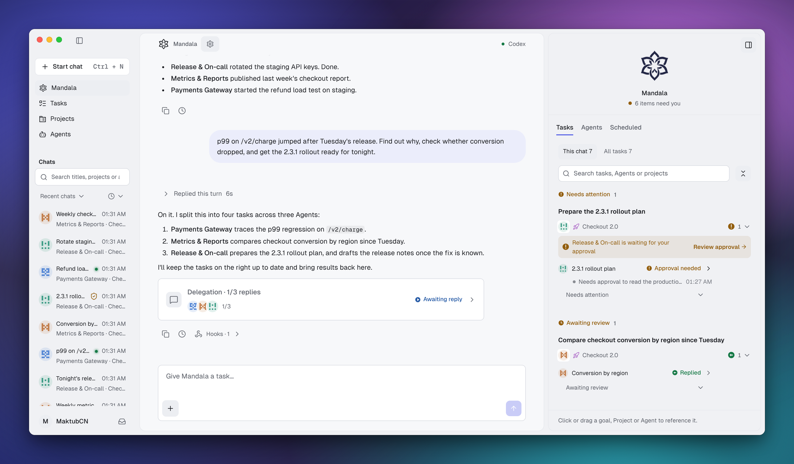
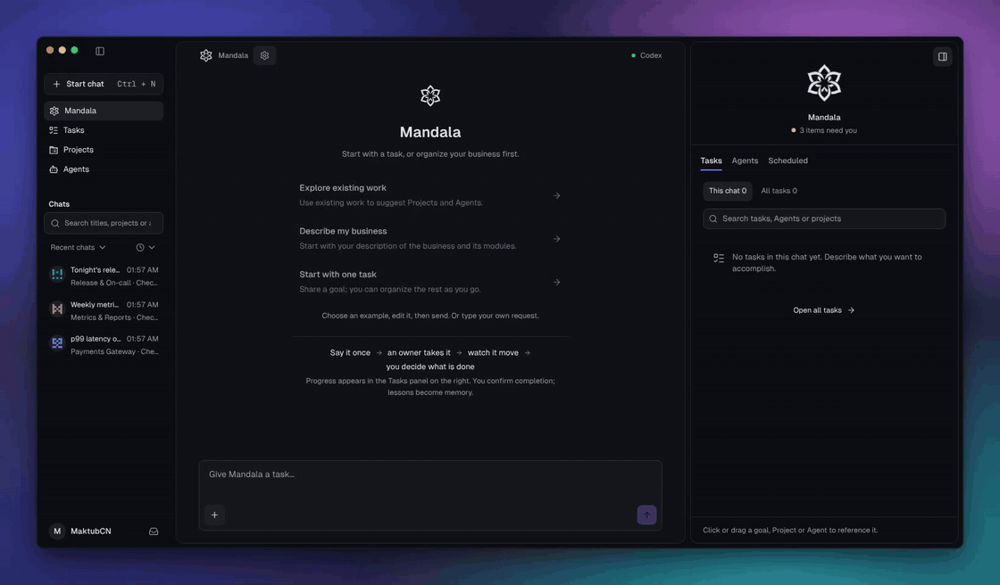
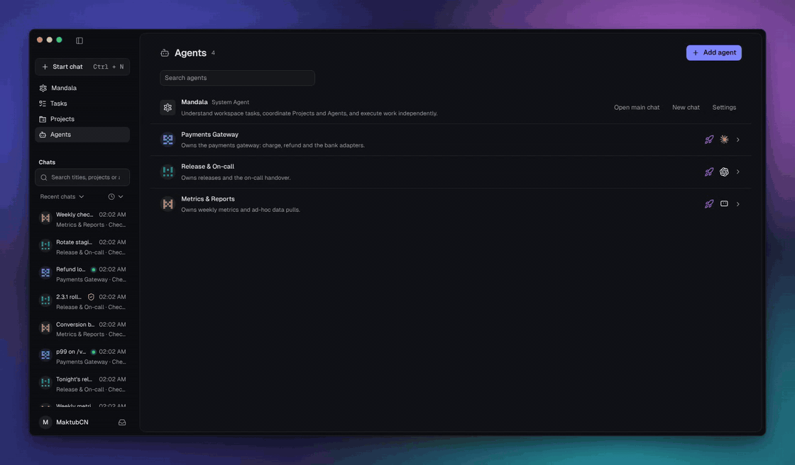
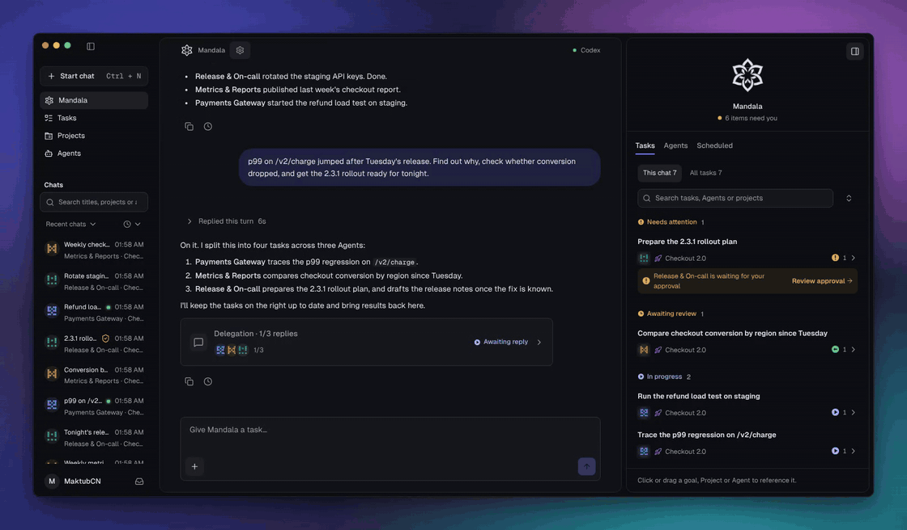
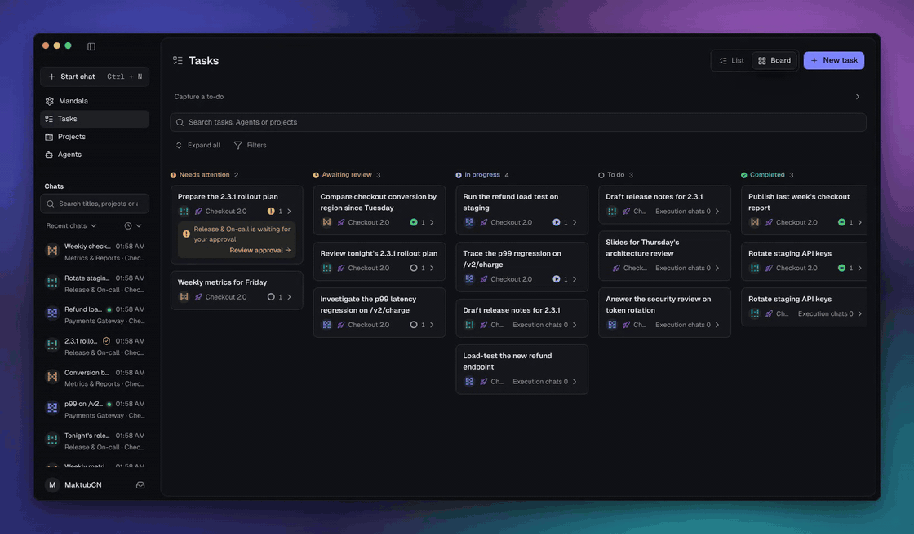
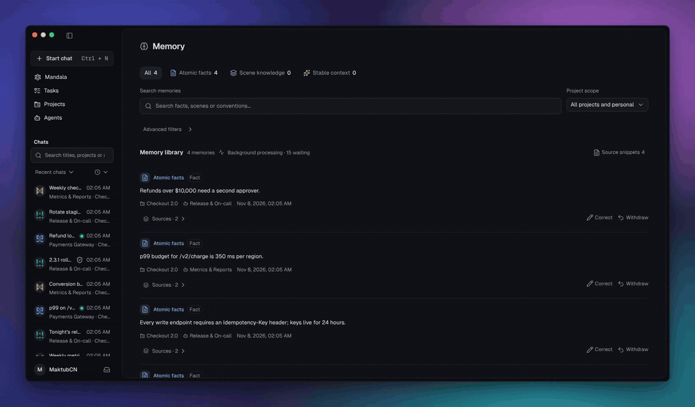
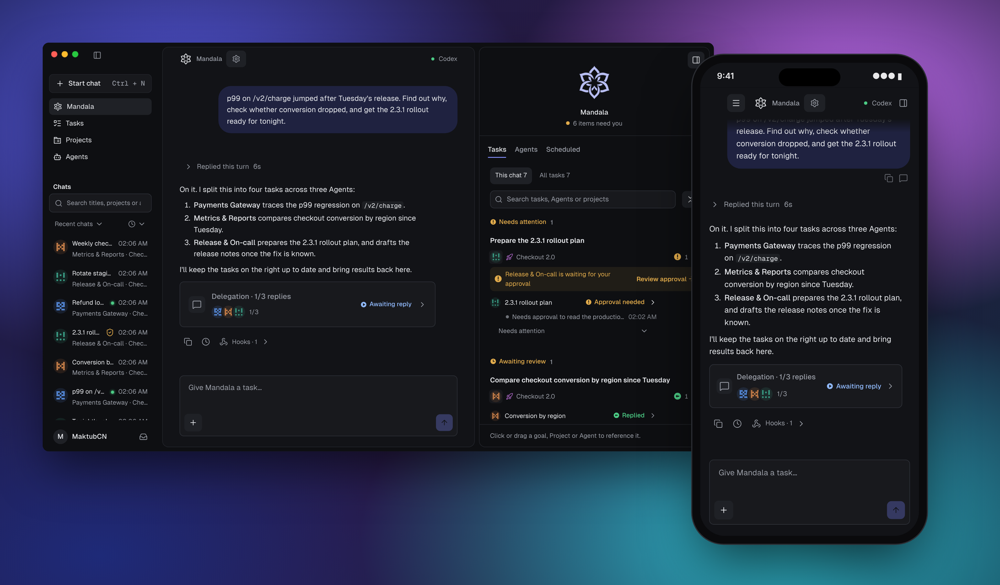
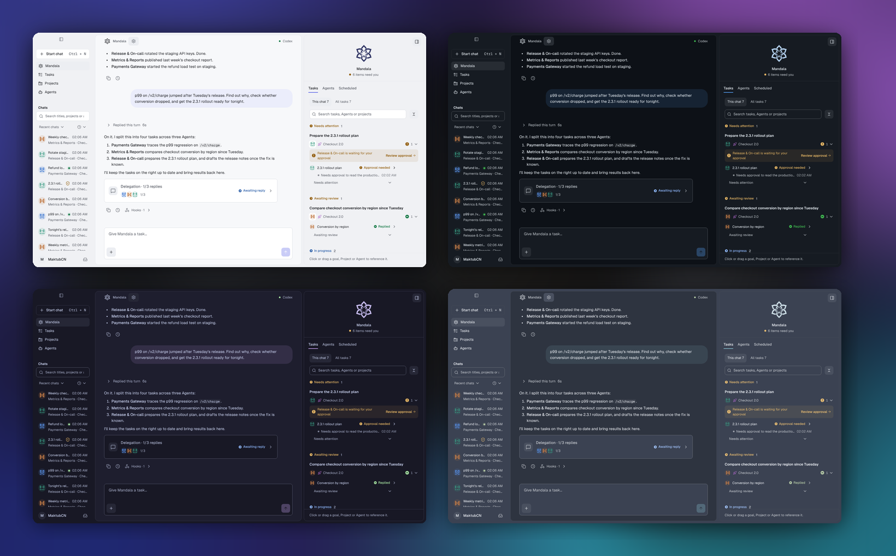

<div align="center">

<picture>
  <source media="(prefers-color-scheme: dark)" srcset="src/assets/logo-on-dark.svg">
  
</picture>

# Mandala

**The AI control room for multithreaded work.**

Bring the AI CLIs you already use. Give every Agent a lasting part of your business.<br>
Mandala keeps track of everything, so every thread of work keeps moving.

[](LICENSE)
[](#get-started)
[](https://github.com/maktub-ai/mandala-releases/releases)
[](https://github.com/maktub-ai/mandala/stargazers)

[Get started](#get-started) · [Runtimes](#runtimes) · [Documentation](#documentation) · [Architecture](#architecture) · [Download](https://github.com/maktub-ai/mandala-releases/releases)

**English** · [简体中文](README.zh-CN.md)

</div>

<br>

<picture>
  <source media="(prefers-color-scheme: dark)" srcset="docs/assets/readme/hero-dark.png">
  
</picture>

<p align="center"><sub>One request, four tasks, three Agents on three CLIs. Running, waiting for approval, ready for review: all in one place. Sample data.</sub></p>

## What is Mandala?

Mandala is a local workspace that sits above your AI coding CLIs. You tell it what needs doing. It turns that into tasks, hands them to long-lived Agents, and brings every result, approval and open question back to one place.

The CLIs still do the work, with their own logins, models and tools. Mandala adds what they don't have: **Agents that own a part of your business, memory that survives a model switch, and one list that remembers what you asked for.**

## One loop, around one center

A mandala is drawn around one center. Mandala works the same way: work leaves you, goes around, and comes back to you for the decisions only you can make. Each time around, your Agents know your business a little better.

### 1. Say it once

Describe what you need in plain words, even when it spans several things. Mandala splits it into tasks, picks the Agent that owns each part, and hands them off. You don't open a terminal per task.



### 2. Every thread has an owner

An Agent is a long-lived owner of one part of your business, like payments, releases or weekly metrics. Each has its own instructions, Skills, MCP connections and memory, and its own runtime and model: Claude Code for hard problems, Kimi or Codex for routine work. Mandala supports 14 CLIs and reuses their own logins, with no model account and no token markup.



### 3. Watch it all move

Every task shows what its Agent is doing right now. Work that needs you, like an approval or an open question, rises to the top. Approvals work the same way on every runtime: on demand, strict or automatic.



### 4. You decide what's done

A run that succeeds is not the same as finished. Open the result, check it against the acceptance criteria, then confirm it or send it back with a reason. One task can hold several execution chats from different Agents and CLIs.



### 5. It remembers next time

Agents keep what they learn as facts, scene knowledge and long-term context, each with its sources. Memory belongs to the Agent, not the model, so it carries over when the Agent switches CLI. Correct or withdraw anything. Shared conventions live in the Project Wiki that every member Agent can read.



<p align="center"><sub>Recorded in the current app with sample data.</sub></p>

## Take it anywhere

Mandala runs on your computer and keeps your data there. When you're away, open it from your phone's browser: pair once from the desktop app, then chat, approve, stop runs and download results. Requests are end-to-end encrypted, and the relay only forwards ciphertext.



The official connection is coming with our hosted relay. Today you can [self-host the relay](docs/personal-connection.md). A native mobile app is on the [roadmap](docs/roadmap.md).

## Make it yours, build it together



Mandala's source is public, and so is everything around it. Themes, language packs and the Mandala pet come from community catalogs on GitHub and install from the in-app Market. The pet sits in the Mandala panel, reacts to what your Agents are doing, and can pop out onto your desktop.

| I want to… | Start here |
|---|---|
| Make a data plugin | [Unified catalog](https://github.com/maktub-ai/mandala-plugins) · [Theme, language and pet protocol](docs/market-ui-extensions.md) |
| Make a theme | Export it from Settings, then open a PR to [mandala-themes](https://github.com/maktub-ai/mandala-themes) |
| Translate Mandala | [mandala-plugins](https://github.com/maktub-ai/mandala-plugins) |
| Draw a pet | [Pet packages](docs/market-ui-extensions.md#pets) |
| Share a Skill or MCP server | Coming soon to the Market |
| Improve Mandala itself | Open an issue or a pull request |

Every package is reviewed before it is listed, and the app installs only the exact version that was reviewed.

## Get started

**Desktop.** Download macOS (`.dmg`, Apple Silicon) or Windows (`.exe`) from [Releases](https://github.com/maktub-ai/mandala-releases/releases). Installers are not yet code-signed: on macOS, right-click Mandala.app and choose **Open** the first time; on Windows, choose **More info → Run anyway** in SmartScreen. Verify downloads against `SHA256SUMS.txt`.

**From source.** Requires Node.js 22.23.2 or later, and at least one supported CLI that already works in your terminal.

```bash
git clone https://github.com/maktub-ai/mandala.git
cd mandala
npm ci && npm run build && npm start
# open http://127.0.0.1:4317
```

### Your first Agent in five minutes

1. **Enable a runtime.** Settings → Runtimes. Mandala detects which CLIs start on your machine.
2. **Create an Agent.** Give it a responsibility, a default runtime and a model.
3. **Hand off work.** Start a chat with the Agent, or tell Mandala and let it create the task.

<details>
<summary>Data directory, port and backups</summary>

```bash
MANDALA_HOME="$HOME/.mandala" MANDALA_PORT=4332 npm start

# Offline snapshot and restore. Stop the service first.
npm run backup  -- --home "$HOME/.mandala" --output "$HOME/mandala-snapshot"
npm run restore -- --input "$HOME/mandala-snapshot" --home "$HOME/.mandala-restored"
```

`MANDALA_HOME` defaults to `~/.mandala` and `MANDALA_PORT` to `4317`. Keep everyday data and test data in separate directories.

</details>

## Runtimes

| Runtime | Notes |
|---|---|
| Codex | — |
| Claude Code | — |
| Gemini CLI | — |
| OpenCode | — |
| OMP | — |
| CodeBuddy | — |
| Kimi | — |
| Grok | — |
| DeepSeek Harness | Tool approval covers the whole turn |
| Antigravity | Tool approval covers the whole turn · no per-session MCP |
| Cursor Agent | Tool approval covers the whole turn · no per-session MCP · models follow your Cursor plan |
| Pi | No per-session MCP |
| Hermes Agent | Native Gateway · whole-turn approval · no session MCP binding |
| OpenClaw | Native Gateway · native default model · whole-turn approval · no per-session MCP |

Every runtime can be enabled, disabled and set as an Agent's default. Credentials are never written to Mandala's config. Actual capability depends on the installed CLI version and its login.

Gateway-backed setup, limitations and live tests: [Hermes Agent / OpenClaw](docs/hermes-openclaw.md).

## Documentation

| I want to… | Read |
|---|---|
| Understand approvals and permissions | [Approval policy](docs/approval-policy.md) |
| Use Mandala from my phone | [Personal connection](docs/personal-connection.md) |
| Self-host the relay service | [Relay deployment](docs/account-service-deployment.md) |
| Build the desktop app or migrate data | [Desktop](docs/desktop.md) |
| Make a theme or language pack | [Market extensions](docs/market-ui-extensions.md) |
| See what's planned | [Roadmap](docs/roadmap.md) |
| Develop, test and release | [Development](docs/development.md) · [Collaboration](docs/collaboration.md) |

## Architecture

```text
 you ──► chat / capture ──► Mandala ─────────────┐
                              │ tasks            │ receipts
              ┌───────────────┼───────────────┐  │
           Agent           Agent           Agent │
         memory · Skills · MCP · Project Wiki    │
              │               │               │  │
         Claude Code        Codex           Kimi ─┘   native CLIs, own logins

 ── one machine ──────────────────────────────────────────────────────
 React UI (browser or Electron)  ◄──►  local Node service  ◄──►  SQLite + files
                                         ▲
                     optional E2EE relay │  phone browser
```

| Layer | Stack |
|---|---|
| UI | React, Vite, Radix, Tailwind |
| Service | Node.js 22, `node:sqlite`, one adapter per native CLI |
| Desktop | Electron with bundled Node.js |
| Remote | TweetNaCl authenticated box, bounded ciphertext relay |
| Tests | Vitest, Playwright |

Settings with the same name resolve as **Project > Agent > native CLI**.

## Development

```bash
npm run dev        # Vite + local API at http://127.0.0.1:4174
npm test           # unit tests
npm run typecheck
npm run test:e2e   # after `npx playwright install chromium` and a build
```

Tests use temporary data and mock protocol endpoints, so they never need your CLI logins. Branching, review and release: [docs/development.md](docs/development.md).

## Why "Mandala"?

A mandala is a circle drawn around one center. Our mark has six petals around an open core: **you, tasks, Agents, memory, the Project Wiki and any CLI**. Work moves out from the center and comes back to it.

## Acknowledgements

Mandala's memory layer builds on [TencentDB Agent Memory](https://github.com/TencentCloud/TencentDB-Agent-Memory) (MIT). We adapted its scene extraction, persona generation and search helpers in `server/vendor/tencentdb/` and use its `@tencentdb-agent-memory/tcvdb-text` package. Thanks to its authors for making it open source.

UI components are adapted from [shadcn/ui](https://github.com/shadcn-ui/ui) and icons come from [Lucide](https://lucide.dev). The full list is in [THIRD_PARTY_NOTICES.md](THIRD_PARTY_NOTICES.md).

## License

Mandala's own code is available under the [Mandala Source-Available License](LICENSE). It is free for personal use and for a single organization's internal use, including internal commercial use. Running Mandala as a hosted service for third parties, paid or free, requires written authorization. It is not an OSI-approved open-source license. Third-party components keep their own terms: [THIRD_PARTY_NOTICES.md](THIRD_PARTY_NOTICES.md).
