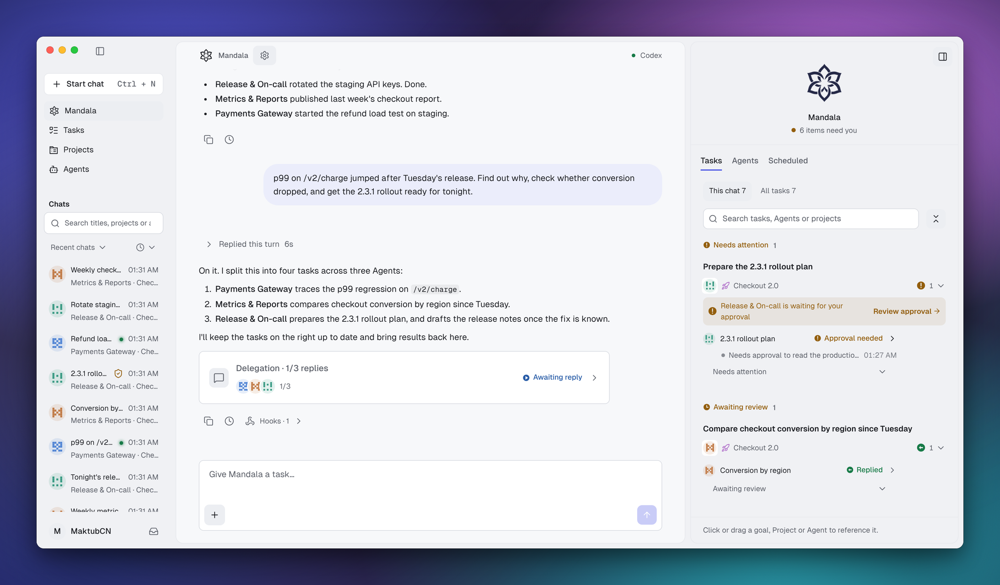
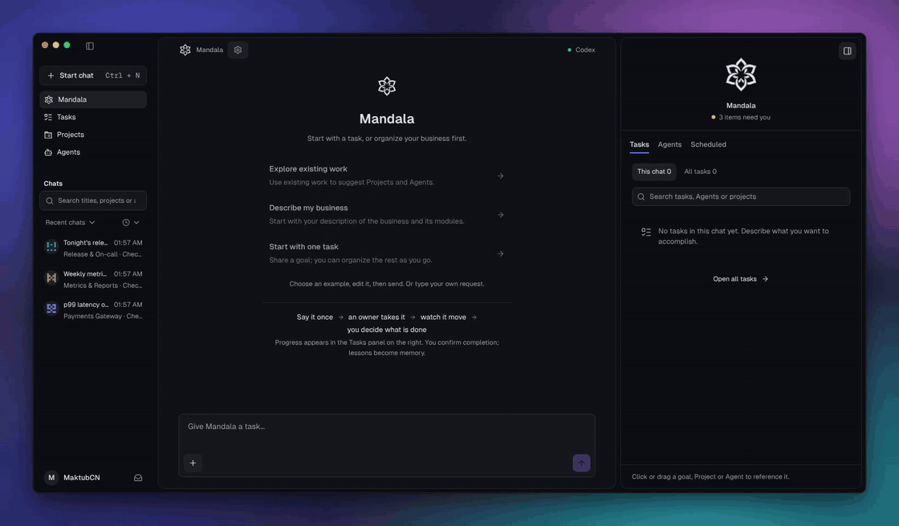
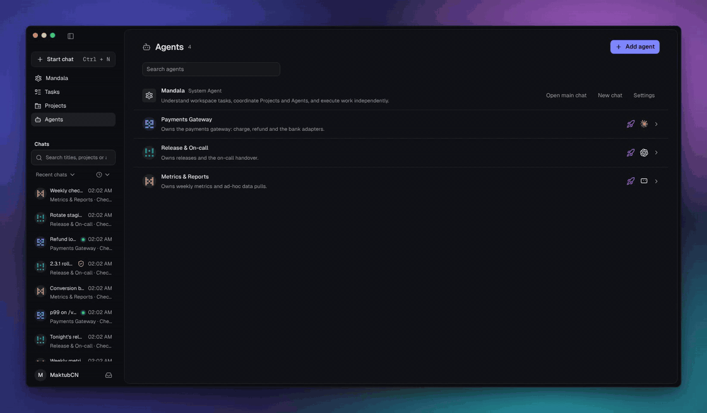
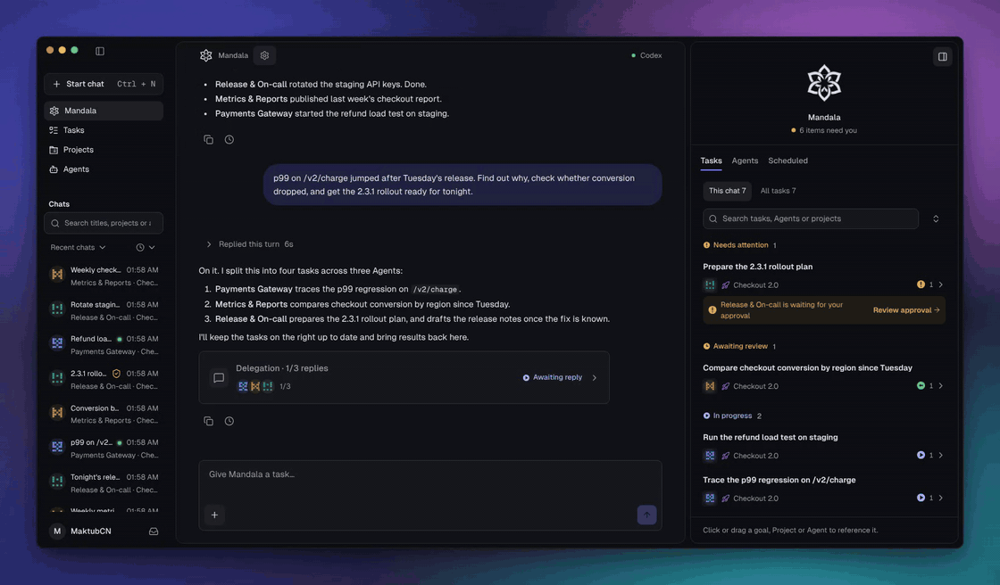
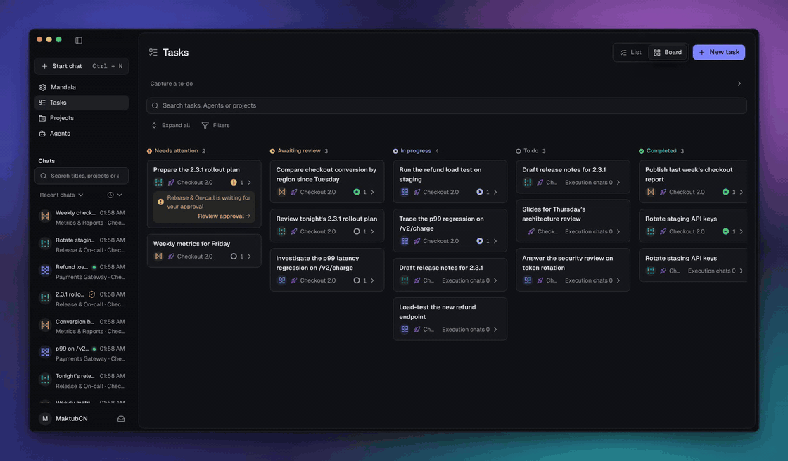
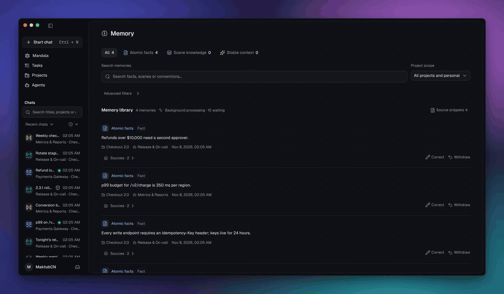
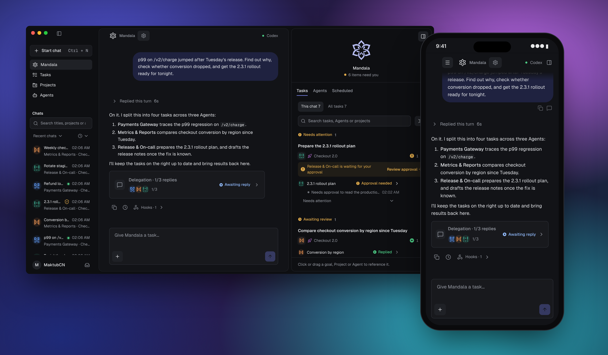
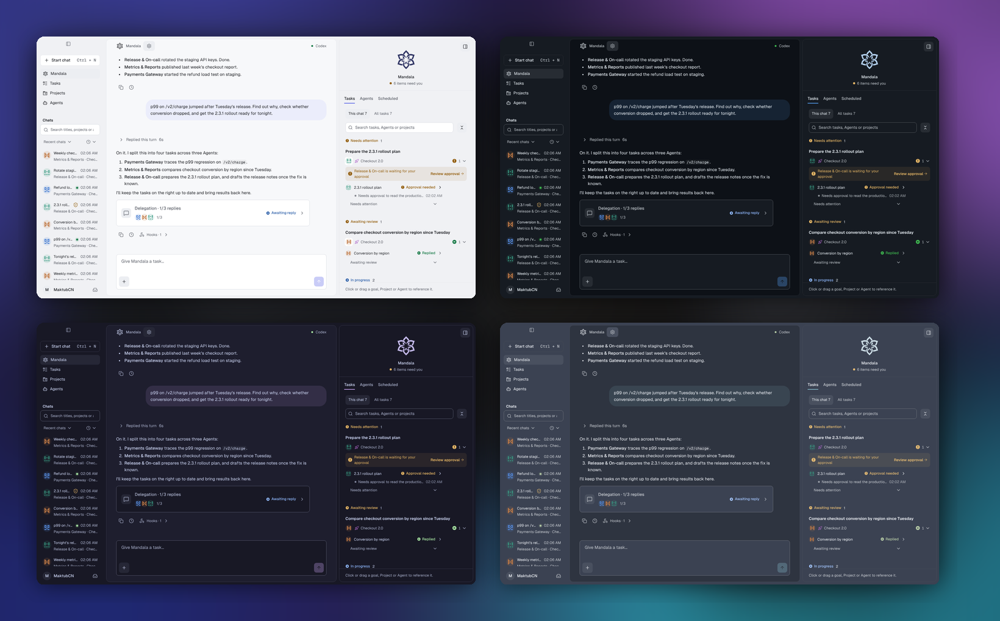
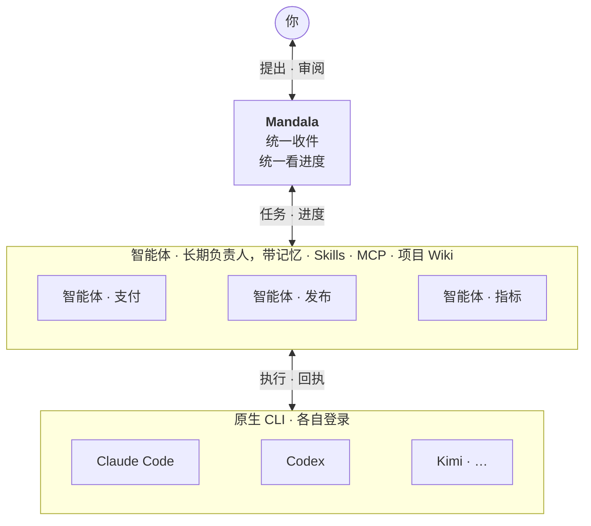
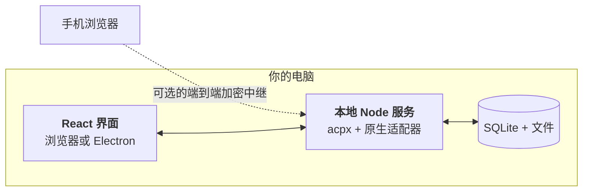

<div align="center">

<picture>
  <source media="(prefers-color-scheme: dark)" srcset="src/assets/logo-on-dark.svg">
  
</picture>

# Mandala

**多线程工作者的 AI 总控台**

一个工作台，带好你的 Agent 团队。<br>
使用你熟悉的 AI 工具，让每位 Agent 围绕业务积累记忆与经验。由 Mandala 统一跟进，让多项工作持续向前。

[](LICENSE)
[](#快速开始)
[](https://github.com/maktub-ai/mandala-releases/releases)
[](https://github.com/maktub-ai/mandala/stargazers)

[官网](https://mandala.pub) · [下载](https://mandala.pub) · [快速开始](#快速开始) · [文档](#文档) · [讨论区](https://github.com/maktub-ai/mandala/discussions)

[English](README.md) · **简体中文**

</div>

<br>

<picture>
  <source media="(prefers-color-scheme: dark)" srcset="docs/assets/readme/hero-dark.png">
  
</picture>

<p align="center"><sub>一个请求、四个任务、三位 Agent、三种 CLI。执行中、等待审批、等待验收，全在一个地方。示例数据。</sub></p>

## Mandala 是什么？

Mandala 是一个位于 AI 编程 CLI 之上的本地工作台。你告诉它要做什么，它把这些事变成任务，交给长期存在的 Agent，再把所有结果、审批和待回答的问题收回到同一个地方。

具体的活仍然由 CLI 来做，用的是它们自己的登录、模型和工具。Mandala 补上的是 CLI 没有的部分：**负责一块业务的 Agent、换了模型也不丢的记忆，以及一个记得你交代过什么的列表。**

有人把这种形态叫作**超级智能体（super agent）**：你只面对一个入口，背后有许多 Agent 在干活。Mandala 补上的是超级智能体通常藏起来的部分：每个 Agent 知道什么、正在做什么、改了什么，你都看得见，什么时候算完成由你决定。

## 一个循环，围绕一个中心

曼陀罗是围绕一个中心画出的圆，Mandala 的工作方式也是这样：工作从你这里出发，绕一圈，在只有你能做决定的地方回到你手上。每转一圈，你的 Agent 都会更懂你的业务。

### 1. 说一次就够

用平常的话说出你要什么，哪怕一句话里包含好几件事。Mandala 会把它拆成任务，交给负责对应模块的 Agent，不用你为每件事单独开一个终端。



### 2. 每条线都有人负责

Agent 是业务里某一块的长期负责人，比如支付、发布或每周数据。每位 Agent 有自己的职责说明、Skill、MCP 连接和记忆，也有自己的执行端和模型：难题交给 Claude Code，日常工作交给 Kimi 或 Codex。Mandala 支持 14 种 CLI，沿用它们自己的登录，不另开模型账号，也不加价。



### 3. 一切都在推进

每个任务都显示它的 Agent 此刻在做什么。需要你处理的事，比如审批或待回答的问题，会排在最前面。审批方式在所有执行端上一致：按需、严格或自动批准。



### 4. 是否完成由你说了算

执行成功不等于完成。打开结果，对照验收标准检查，然后确认完成，或者写明原因退回修改。一个任务可以包含来自不同 Agent 和 CLI 的多个执行对话。



### 5. 下一次它记得

Agent 会把学到的东西整理成原子事实、场景知识和长期上下文，每条都附带来源。记忆属于 Agent，而不是某个模型，所以换了 CLI 也依然都在。任何一条都可以纠正或撤回。共享的约定放在项目 Wiki 里，成员 Agent 都能读到。



<p align="center"><sub>录制自当前版本的 App，使用示例数据。</sub></p>

## 随时随地

Mandala 运行在你的电脑上，数据也留在那里。出门在外时，用手机浏览器打开它：在桌面端配对一次，之后就能对话、审批、停止执行和下载结果。请求全程端到端加密，中继只转发密文。



官方连接会随官方中继一起上线，目前可以[自托管中继](docs/personal-connection.md)。原生手机 App 已列入[路线图](docs/roadmap.md)。

## 按你的喜好，一起共建



Mandala 的源码是公开的，围绕它的一切也是。主题、语言包和 Mandala 宠物都来自 GitHub 上的社区目录，在 App 内的 Market 里安装。宠物住在 Mandala 侧栏里，会随 Agent 的工作状态变化，也可以弹出到桌面上。

| 我想要… | 从这里开始 |
|---|---|
| 制作数据型插件 | [统一插件目录](https://github.com/maktub-ai/mandala-plugins) · [主题、语言包和桌宠协议](docs/market-ui-extensions.md) |
| 做一套主题 | 在设置里导出，再向 [mandala-themes](https://github.com/maktub-ai/mandala-themes) 提交 PR |
| 把 Mandala 翻译成我的语言 | [mandala-plugins](https://github.com/maktub-ai/mandala-plugins) |
| 画一只宠物 | [宠物包说明](docs/market-ui-extensions.md#pets) |
| 分享 Skill 或 MCP | 即将在 Market 开放 |
| 改进 Mandala 本身 | 提 Issue 或 Pull Request |

每个包上架前都会经过审核，App 只会安装审核过的那个版本。

## 快速开始

**桌面版。** 从 [官网](https://mandala.pub) 或 [Releases](https://github.com/maktub-ai/mandala-releases/releases) 下载 macOS（`.dmg`，Apple Silicon）或 Windows（`.exe`）安装包。安装包暂未做代码签名：macOS 首次打开请右键 Mandala.app 选择「打开」；Windows 在 SmartScreen 提示中选择「更多信息 → 仍要运行」。下载后可用 `SHA256SUMS.txt` 校验。

**从源码运行。** 需要 Node.js 22.23.2 或更高版本，以及至少一个已在终端里能正常使用的受支持 CLI。

```bash
git clone https://github.com/maktub-ai/mandala.git
cd mandala
npm ci && npm run build && npm start
# 打开 http://127.0.0.1:4317
```

### 五分钟用上第一位 Agent

1. **启用执行端。** 设置 → 执行端接入，Mandala 会检测本机哪些 CLI 可以启动。
2. **创建 Agent。** 给它一份职责、一个默认执行端和模型。
3. **交出工作。** 直接和这位 Agent 开始对话，或者告诉 Mandala，让它来创建任务。

<details>
<summary>数据目录、端口与备份</summary>

```bash
MANDALA_HOME="$HOME/.mandala" MANDALA_PORT=4332 npm start

# 离线快照与恢复，先停止服务
npm run backup  -- --home "$HOME/.mandala" --output "$HOME/mandala-snapshot"
npm run restore -- --input "$HOME/mandala-snapshot" --home "$HOME/.mandala-restored"
```

`MANDALA_HOME` 默认是 `~/.mandala`，`MANDALA_PORT` 默认是 `4317`。日常数据和测试数据请放在不同目录。

</details>

## 执行端

| 执行端 | 说明 |
|---|---|
| Codex | — |
| Claude Code | — |
| Gemini CLI | — |
| OpenCode | — |
| OMP | — |
| CodeBuddy | — |
| Kimi | — |
| Grok | — |
| DeepSeek Harness | 工具授权覆盖整轮执行 |
| Antigravity | 工具授权覆盖整轮执行 · 不支持会话级 MCP |
| Cursor Agent | 工具授权覆盖整轮执行 · 不支持会话级 MCP · 模型权限由 Cursor 账号计划决定 |
| Pi | 不支持会话级 MCP |
| Hermes Agent | 原生 Gateway · 整轮授权 · 暂不绑定会话 MCP |
| OpenClaw | 原生 Gateway · 原生默认模型 · 整轮授权 · 不支持会话级 MCP |

每个执行端都可以启用、停用，并设为 Agent 的默认执行端。凭据不会写入 Mandala 的配置。实际能力取决于本机安装的 CLI 版本和登录状态。

Gateway 配置、能力限制与真实验收步骤见 [Hermes Agent / OpenClaw](docs/hermes-openclaw.md)。

## 文档

| 我想要… | 阅读 |
|---|---|
| 了解审批和权限 | [审批规则](docs/approval-policy.md) |
| 在手机上使用 Mandala | [连接说明](docs/personal-connection.md) |
| 自托管中继服务 | [服务部署说明](docs/account-service-deployment.md) |
| 构建桌面版或迁移数据 | [桌面说明](docs/desktop.md) |
| 制作主题或语言包 | [主题与语言包](docs/market-ui-extensions.md) |
| 看看接下来的计划 | [路线图](docs/roadmap.md) |
| 参与贡献 | [贡献指南](CONTRIBUTING.md) · [行为准则](CODE_OF_CONDUCT.md)（英文） |
| 报告安全问题 | [安全策略](SECURITY.md)（英文） |
| 开发、测试与发布 | [开发与运维说明](docs/development.md) · [协作与发布流程](docs/collaboration.md) |

## 架构

工作怎么流转：你和 Mandala 对话，Mandala 把任务交给长期负责的智能体，每个智能体再通过你已经在用的原生 CLI 去执行。



各部分运行在哪里：全部留在你的电脑上。手机可以通过可选的端到端加密中继连接。



| 层 | 技术 |
|---|---|
| 界面 | React、Vite、Radix、Tailwind |
| 服务 | Node.js 22、`node:sqlite`，acpx ACP 运行时 + 原生 CLI 适配器 |
| 桌面 | Electron，内置 Node.js |
| 远程 | TweetNaCl authenticated box，有界的密文中继 |
| 测试 | Vitest、Playwright |

同名配置按 **Project > Agent > 原生 CLI** 的优先级生效。

## 开发

```bash
npm run dev        # Vite + 本地 API，访问 http://127.0.0.1:4174
npm test           # 单元测试
npm run typecheck
npm run test:e2e   # 需先 `npx playwright install chromium` 并完成构建
```

测试使用临时数据和模拟协议端点，不需要你的 CLI 登录态。分支、审阅与发布流程见 [docs/development.md](docs/development.md)。

## 为什么叫 Mandala？

曼陀罗（Mandala）是围绕一个中心画出的圆。我们的标志是围绕一个开放核心的六片花瓣：**你、任务、Agent、记忆、项目 Wiki 和任意 CLI**。工作从中心出发，最后回到中心。

## 致谢

Mandala 的 ACP 通信复用 [acpx 的轻量 MIT fork](https://github.com/maktub-ai/acpx)，上游是 [OpenClaw/acpx](https://github.com/openclaw/acpx)。我们复用了 Paperclip 的宿主进程启动扩展并保留来源声明，将通用兼容补丁拆成独立上游贡献；ACP 尚未覆盖的能力继续使用原生适配器。详见 [CLI 能力表与更新流程](docs/cli-adapters.md)。

Mandala 的记忆模块借鉴了 [TencentDB Agent Memory](https://github.com/TencentCloud/TencentDB-Agent-Memory)（MIT 许可）。我们改编了它的场景提取、画像生成和检索工具（位于 `server/vendor/tencentdb/`），并使用了它的 `@tencentdb-agent-memory/tcvdb-text` 包。感谢作者将它开源。

界面组件改编自 [shadcn/ui](https://github.com/shadcn-ui/ui)，图标来自 [Lucide](https://lucide.dev)。完整列表见 [THIRD_PARTY_NOTICES.md](THIRD_PARTY_NOTICES.md)。

## 许可

Mandala 的原创代码按 [Mandala Source-Available License](LICENSE) 提供。个人使用和单一组织的内部使用免费，包括内部商业使用。向第三方提供托管服务，无论收费或免费，都须事先取得书面授权。这不是 OSI 批准的开源许可。第三方组件适用各自的条款，见 [THIRD_PARTY_NOTICES.md](THIRD_PARTY_NOTICES.md)。
