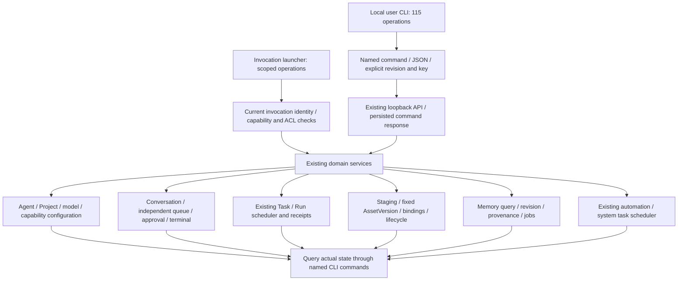

# OpenMana business CLI

The dependency-free Node executable `cli/openmana.mjs` provides named business commands for the local service. Run it with `npm run cli -- …`, `node cli/openmana.mjs …`, or the installed `openmana` bin. Node must satisfy the repository's engine requirement.

```sh
npm run cli -- --help
node cli/openmana.mjs tasks --help
node cli/openmana.mjs tasks start --help
node cli/openmana.mjs service status
```

Commands use `openmana <group> <action> [ids]`. IDs are ordered as shown in action help and URL encoded. `--data` supplies a JSON object body, `--query` supplies a JSON object of scalar query values, and either accepts `@/absolute/file.json`. Request field validation remains with the existing API.

All results are JSON. Successful commands print one line to stdout with `{ok:true,command,commandKey?,data}`. Errors print `{ok:false,command,commandKey?,error:{code,message,status?,details?}}` to stderr and exit 1. `--json` is accepted for callers that explicitly request JSON. Event commands emit one success envelope per SSE message and remain connected until the stream closes or the caller interrupts them; `conversations history` provides a finite read.

## Local user commands

The default service URL is `http://127.0.0.1:4332`. Set `--base-url` or `OPEN_MANA_BASE_URL` to another loopback URL. Credentials, URL paths, queries, fragments, non-loopback destinations, shorthand IP addresses, and redirects are rejected. User mode has the same local OS trust boundary as the existing local user HTTP API: it assumes that the person running the executable may control their local OpenMana service.

| Group | Actions |
| --- | --- |
| `service` | `status` |
| `config` | `get`, `put` |
| `agents`, `projects` | `list`, `get`, `upsert`, `remove` |
| `project` | `agents` |
| `directories` | `list` |
| `capabilities` | `list`, `effective` |
| `models`, `cli` | `models list`, `cli status` |
| `knowledge` | `list`, `create`, `update`, `remove` |
| `conversations` | `list`, `create`, `get`, `rename`, `workspace`, `workspace-file`, `local-file`, `upload`, `attachment`, `model`, `queue`, `enqueue`, `cancel-input`, `approval-mode`, `history`, `events`, `completion`, `archive`, `title`, `memory`, `fork`, `branch`, `edit`, `send`, `continue`, `stop`, `answer`, `approve` |
| `messages` | `ask`, `get` |
| `tasks` | `list`, `get`, `control`, `create`, `adopt-plan`, `source`, `start`, `stop`, `cancel`, `complete`, `accept`, `reopen`, `request-changes`, `assign`, `delegate`, `legacy-list` |
| `assets` | `list`, `create`, `get`, `upload`, `import`, `versions`, `publish`, `version`, `read`, `inspect`, `access`, `lifecycle`, `bindings`, `bind`, `unbind`, `maintenance`, `maintain`, `update` |
| `memory` | `list`, `search`, `organize`, `jobs`, `result`, `source`, `read`, `correct`, `retract` |
| `market` | `search`, `detail`, `installed`, `install`, `unlink`, `uninstall` |
| `automations` | `list`, `create`, `update`, `remove`, `run`, `stop` |
| `terminal` | `get`, `open`, `close`, `input`, `resize`, `events` |
| `system-tasks` | `status`, `run`, `stop` |

`cli/commands.mjs` is the shared command inventory. Invocation-only skill commands require the runtime launcher; the historical token-based `/api/task-tools` protocol is not a public CLI command.

### Safe retries and revisions

JSON mutations receive an `Idempotency-Key` and `X-OpenMana-CLI: 1` header. `--key` supplies a stable key (`--command-key` is an alias); when omitted, a UUID is generated and included in success or error output. The service stores the response so that an exact manual retry with the same key does not run the mutation again. Reusing a key with different input is an error. The CLI never automatically retries requests.

Keep the returned key if a response is lost or a command fails; query the resulting task or entity before deciding to issue a new command. Domain revisions and expected output/head checks still apply. POST reads such as memory search and file preview do not use the mutation receipt ledger. Raw binary uploads also do not use it: retrying an upload creates another staging submission.

```sh
node cli/openmana.mjs config get
node cli/openmana.mjs agents list
node cli/openmana.mjs agents get agent-id
node cli/openmana.mjs agents upsert --data @/tmp/agent-edit.json --key agent-edit-1
# agent-edit.json: {"revision":"<from config get>","agent":{...complete agent with id...}}
node cli/openmana.mjs projects remove project-id --data '{"revision":"<revision>"}' --key remove-project-1
```

Entity edits submit the original operation to `/api/cli/config/agents|projects/upsert|remove`. The service reads the configuration, replaces/removes only the requested entity, and writes it with the explicitly supplied revision. Removing an Agent also removes that ID from project memberships in the same revision-checked write. Other configuration fields are preserved; the service does not silently substitute the current revision or retry conflicts. Recording the original operation makes an exact manual retry safe after a deletion or an unrelated configuration edit. `upsert` takes a complete `agent` or `project`; it replaces an existing entity with that ID. `config put --data @file.json` accepts the API's complete `{revision,config}` payload.

### Conversations and tasks

```sh
node cli/openmana.mjs conversations create --data '{"projectId":"project-id","agentId":"agent-id","cli":"codex"}' --key create-chat-1
node cli/openmana.mjs conversations send chat-id --data '{"text":"Review the draft","attachments":[]}' --key send-1
node cli/openmana.mjs conversations enqueue chat-id --data '{"text":"Independent follow-up"}' --key enqueue-1
node cli/openmana.mjs conversations history chat-id --query '{"after":0}'
node cli/openmana.mjs conversations approve chat-id approval-id --data '{"decision":"approve"}' --key approve-1
node cli/openmana.mjs conversations answer chat-id question-id --data '{"answers":{}}' --key answer-1
node cli/openmana.mjs conversations workspace-file chat-id --data '{"path":"README.md"}'
node cli/openmana.mjs tasks create --data '{"goal":"Write a report","criteria":[],"acceptance":"delivery","projectId":"project-id","assigneeAgentId":"agent-id","parentTaskId":null}' --key task-1
node cli/openmana.mjs tasks start task-id --data '{"expectedRevision":1}' --key start-1
node cli/openmana.mjs tasks control task-id
node cli/openmana.mjs tasks request-changes task-id --data '{"expectedRevision":3,"reason":"Add evidence"}' --key changes-1
```

`messages ask/get` handles a simple confirmation without creating a Task. Both messages and new delegations default to `resume`; explicit `notify` only stores the reply. Source stop revokes queued auto replies durably while the recipient continues. Message calls return before execution; a queued or unknown state is not a delivered answer. After a resume inquiry, yield the turn instead of polling while holding its directory. A receiver turn that is still waiting for its own resume inquiries is intermediate: only its final checked reply propagates upstream. A platform-created dedicated receiver is marked completed in Progress only after a successful final answer with no human input, linked Task or pending work. Explicit reopen or a human follow-up permits continued discussion; failed/unknown execution is not completed. No new Task or small-talk category is introduced.

`tasks list/get/control/create/...` use durable `/api/v2/tasks` APIs. `tasks legacy-list` and local user `tasks delegate` expose the existing helper-task API. In local user mode, delegation additionally requires `sourceConversationId` in `--data`; `--key` is forwarded as its `commandKey`.

### Assets, memory, installation and automation

```sh
node cli/openmana.mjs assets upload --input /tmp/report.txt --query '{"name":"report.txt"}'
node cli/openmana.mjs assets import --data '{"kind":"document","title":"Report","submissionId":"<upload result>"}' --key import-1
node cli/openmana.mjs assets publish asset-id --data '{"expectedHeadVersionId":"version-id","submissionId":"<upload result>","provenance":{"sourceVersions":[]}}' --key publish-1
node cli/openmana.mjs assets read asset-id version-id 0 --output /tmp/download.txt
node cli/openmana.mjs assets inspect asset-id version-id 0
node cli/openmana.mjs assets read asset-id version-id 0 --range bytes=0-99 --output /tmp/first-100.bin
node cli/openmana.mjs assets access asset-id --data '{"expectedRevision":1,"policy":{"mode":"private","agentIds":[],"projectIds":[]}}' --key access-1
node cli/openmana.mjs memory search --data '{"projectId":"project-id","query":"release decision"}'
node cli/openmana.mjs memory correct record-id --data '{"expectedRevision":1,"text":"Corrected fact"}' --key correct-1
node cli/openmana.mjs memory organize --data '{"conversationId":"chat-id"}' --key organize-1
node cli/openmana.mjs memory jobs
node cli/openmana.mjs memory result job-id
node cli/openmana.mjs market search --query '{"kind":"skill","query":"review"}'
node cli/openmana.mjs market install --data @/tmp/install.json --key install-1
node cli/openmana.mjs automations create --data @/tmp/automation.json --key automation-1
node cli/openmana.mjs automations run automation-id --key run-automation-1
```

Binary downloads require `--output` and never put file bytes in JSON stdout. Uploads require `--input` and pass filename metadata via `--query`. The API still enforces upload limits and authorizations. `assets inspect` performs HEAD and returns HTTP headers; `assets read` supports `--range` and `--if-range`.

### Terminal and system tasks

```sh
node cli/openmana.mjs terminal open chat-id --data '{"cols":100,"rows":30}' --key terminal-1
node cli/openmana.mjs terminal input chat-id --data '{"sessionId":"session-id","data":"pwd\n"}' --key input-1
node cli/openmana.mjs terminal events chat-id --query '{"sessionId":"session-id"}'
node cli/openmana.mjs terminal close chat-id --data '{"sessionId":"session-id"}' --key close-1
node cli/openmana.mjs system-tasks status chat-id
node cli/openmana.mjs system-tasks run chat-id title --key title-1
node cli/openmana.mjs system-tasks stop chat-id title --key stop-title-1
```

System task `kind` is `title` or `memory`. The existing layered memory pipeline currently cannot stop one targeted memory job; the API reports an explicit 409 unsupported result for that case. Query `memory jobs` and `memory result` for its actual state.

## Bound Agent mode

The runtime supplies an invocation-specific executable launcher and a private `OPEN_MANA_CONTEXT` JSON file containing `{baseUrl,token}` and, for constrained Codex executions, an optional `mailboxPath`. The file must be an owned regular file with no group/other access; symbolic links are rejected. In HTTP mode the token is sent as a Bearer header. It is never accepted from command arguments or printed.

The same named commands route through `POST /api/cli/invoke` with `{command,args,commandKey}`. Constrained Codex cannot access the loopback network, so its runtime instead supplies an owned private directory exactly `mailbox` beside the context file. The CLI atomically publishes one UUID request file containing the same command payload; the host invokes the same permission checks and returns a private UUID response file. The client rejects response symlinks and results above 8 MiB, waits up to 120 seconds, removes its files after completion/error/timeout, and never retries. A timeout reports an unconfirmed command; use the same stable key for a deliberate retry after querying the result.

Agent mode allows only the following commands; the host additionally checks the current invocation, declared capabilities and resource permissions on every call. It rejects destination overrides, query options, identity fields and all other commands. A stopped or finished invocation's launcher cannot continue invoking commands, and its mailbox is removed.

| Agent command | Bound capability | Input |
| --- | --- | --- |
| `tasks context` | `task_context` | No arguments; descriptive current context only |
| `tasks list` | `task_list` | Optional `--data {"query":"…","projectId":"…","conversationId":"…"}` |
| `tasks get` | `task_read` | `taskId`; returns the authorized Task |
| `tasks create` | `task_create` | Goal; explicit `projectId` (null allowed) and `conversationIds` ([] allowed); optional criteria, participants, assignee and parent |
| `tasks update` | `task_update` | `taskId`, `expectedRevision` and edited attributes; nonterminal progress only |
| `tasks mark-completed` | `task_mark_completed` | `taskId`, `expectedRevision`; explicitly finish; the current executing Agent instead records an intent applied after its successful settled final turn |
| `tasks review` / `tasks complete` | `task_review` | `taskId`, `expectedRevision`; request review, not final completion |
| `tasks accept` | `task_accept` | `taskId`, `expectedRevision`; accept a reviewed Task |
| `tasks reopen` / `tasks request-changes` | `task_reopen` / `task_request_changes` | `taskId`, `expectedRevision`; optional reason for reopen, required reason for requested changes; optional exact expectedOutput |
| `tasks assign` | `task_assign` | `taskId`, `expectedRevision`, `agentId` (null allowed) |
| `tasks cancel` | `task_cancel` | `taskId`, `expectedRevision`; explicitly stop the current Run and cancel the goal; requires current revision and Task access |
| `tasks link` / `tasks unlink` | `task_link` / `task_unlink` | `taskId conversationId`, `--data {"expectedRevision":1}` |
| `conversations list` | `conversation_list` | Optional query, project and Agent filters in `--data`; authorized metadata only |
| `conversations get` / `conversations history` | `conversation_read` / `conversation_history` | `conversationId`; authorized conversation events; history optionally accepts `after` |
| `project agents` | `project_agents` | No arguments; host determines project |
| `tasks delegate` | `delegate` | `--data {"targetAgentId":"…","request":"…","targetConversationId":"…","policy":"resume"}`; last two fields optional; new delegations default to resume |
| `messages ask` | `message_ask` | `--data {"targetAgentId":"…","text":"…","targetConversationId":"…","policy":"resume"}`; last two fields optional; simple confirmation without creating a Task |
| `messages get` | `message_read` | `<messageId>`; request outcome, reply text and reply delivery state |
| `assets publish` | `artifact_publish` | `--data {"title":"…","files":[{"path":"relative/output.txt"}]}`; paths are within the declared output root |
| `assets update` | `artifact_update` | `--data {"assetId":"…","expectedHeadVersionId":"…","path":"relative/output.md"}`; enabled target owned by this Agent, current exact project policy, stable `--key` |
| `assets read` | `artifact_read` | `assetId versionId fileId`, or those fields in `--data` |
| `memory search` | `memory_search` | `--data {"query":"…"}`; host determines scope |
| `memory read` | `memory_read` | `recordId`, or `--data {"recordId":"…"}` |
| `skills find` | `skill_find` | Optional `--data {"query":"…"}`; system-managed content only |
| `skills read` | `skill_read` | `skillId`, or `--data {"skillId":"…"}` |
| `skills register` | `skill_register` | `--data {"name":"query-review","content":"<complete SKILL.md>"}`; creates without assigning |

Agent `assets publish` takes the runtime's output files; local user `assets publish assetId` publishes an uploaded staging submission to an explicit existing Asset. Agent `assets read` returns the bound tool's JSON result and does not accept `--output`. Stable mutation retries use the same `--key` and exact arguments; fresh invocations receive fresh identities.

### Maintained local text files

Human owners opt in through Files → File settings or `assets maintain assetId --data '{"enabled":true,"agentId":"agent-id","projectId":null,"expectedRevision":0}'`. `assets maintenance assetId` reads the saved policy and latest check. Enabling explicitly assigns a human import to the selected Agent and associates its latest version; an existing Agent owner cannot be silently reassigned. `projectId:null` selects that Agent's conversations, including its projects; a project ID selects only that exact project and requires current membership. Disabling uses the current maintenance revision and does not withdraw existing versions.

Only an active owner-only single UTF-8 text/JSON file up to 24,000 JavaScript characters qualifies. Automatic maintenance uses the Agent's enabled Codex/OMP model for a restricted whole-text transformation; ACP runtimes are rejected. Replacement JSON must fit 32 KiB UTF-8. The complete summary is limited to 12,000 JavaScript UTF-16 characters (including chunk separators). The serialized summary snapshot (including source metadata/escaping) and whole serialized generator prompt are each limited to 128 KiB UTF-8. Overflow records a small failed watermark with an explicit summary/snapshot/input reason and makes no model call; input is never silently truncated. Complete successful saved session consolidation, all original summary chunks, current cursor hashes and current source/dependency authority are required. Raw chunks, request memory, failed/partial pipelines and historical completed jobs at enable time never trigger updates. The check is a fixed transformation, with no project memory, task, user chat or publication tools created. Native login/global extensions are not an OS sandbox guarantee.

`assets update` is available only through an active Agent invocation, using its supplied launcher and declared output root. It targets an explicitly maintained file and an exact original head; it preserves the actual invocation/Run provenance and original filename. Identity and project are never command arguments. A different project, ownership, policy revision, unsafe path, expired invocation or concurrent edit denies publication. Identical bytes produce no new version. Source visibility must remain safe for an Agent-owned destination; private external or project-only provenance is rejected rather than discarded.

Automatic model usage is recorded separately as `fileMaintenance`, including chosen Agent/model/project/source conversation and each real execution ID. Each pending check chooses the current head/text only when it first executes, then persists that immutable baseline before generation. Later queued sessions see prior updates; generated/interrupted retries retain their original baseline and cannot overwrite a subsequent human edit. Generated output is persisted before staging, so restart resumes it without another model call. An interrupted generation may retry once after restart with a fresh usage ID; failed output is not automatically retried. Main and Desktop enforce one running service per HOME before migrations; other HOMEs remain independent. A process interrupted during stale-lock recovery leaves a conservative recovery-directory blocker that requires inspection before removal. New versions retain unique direct predecessors and actual direct invocation sources; recursive reads validate each graph node once per principal/scope-specific synchronous query, reject cycles and recheck authorization on every later query. A revoked derived file is marked unavailable in the Files index while unrelated healthy files remain available. Saved maintained versions retain their original summary evidence guard: disabling maintenance preserves reads, while revoked evidence or an unauthorized Agent denies derived reads.

### Managed skill registration

Use the invocation's exact launcher path with these arguments:

```sh
openmana skills find --data '{"query":"query review"}'
openmana skills read <skill-id>
openmana skills register --data @skill.json --key register-query-review
```

`skill.json` contains `name` and `content`. The content must be complete `SKILL.md`, with matching `name` and a nonempty `description` in its YAML header. Tool registration accepts at most 100 KiB of UTF-8 content; the UI/config limit is 200,000 characters. CLI requests retain the overall 256 KiB transport limit.

These tools access only managed content in the current system's shared skill library. They do not read external directories or accept path, project, Agent or account identity overrides. Find returns at most 100 results and reports `truncated`; narrow the query when necessary. Read returns the saved content.

Register adds an asset without assigning or loading it into any Agent, and returns readback with `revision` and `assigned: false`. Existing names cannot be registered again. Repeating the same key and input returns the same asset's current saved state; changed input conflicts, and deleting a registered asset does not allow a retry to recreate it. Revision conflicts preserve concurrent edits and permit retry with the same key. Interrupted registrations with an unknown persistence outcome remain unconfirmed; inspect the library before issuing another command. Tool authorization expires when the invocation ends or stops, including while a write is queued.

## Business flow and result checkpoints



```mermaid
sequenceDiagram
  actor User
  participant CLI as Business CLI
  participant Host as Existing platform backend
  participant Agent as Native Agent invocation
  participant Helper as Delegated Task / Run
  User->>CLI: config get; entity upsert with revision
  CLI->>Host: shared config validation and persisted response key
  User->>CLI: conversations create / send
  CLI->>Host: existing Conversation and queue rules
  Host->>Agent: private launcher, fresh bound identity
  Agent->>Host: project agents; memory search / read
  Agent->>Host: tasks delegate with stable key
  Host->>Helper: existing scheduler, distinct Run and output root
  Helper->>Host: assets publish; assets read fixed version
  Host-->>Agent: receipt; resume by default, notify when explicit
  User->>CLI: tasks get; assets version / read
  CLI-->>User: persisted Run state, receipt and exact version bytes
```

A successful HTTP response or native model message is not proof of delivered output. Read Task/Run state, receipt count, fixed AssetVersion and its bytes. Independent queued work retains its own stop semantics; stopping the source invocation revokes its launcher and does not automatically restart unfinished work.

## Native permissions and transport

Full-access Codex and OMP use loopback HTTP. Constrained Codex uses file IPC because native sandbox network restrictions can deny loopback access. Its mailbox is a separate private invocation directory, not a project write grant. Legacy workspace-write uses the existing runtime writable-root mechanism. Native read-only and named permission profiles receive an invocation-specific profile extending the original profile, with write access only to the exact mailbox. Native approval, project file restrictions, network policy and inherited deny rules remain active. Administrator requirements that reject the derived profile fail explicitly; the platform does not switch to unrestricted execution.

The built-in `openmana_tasks` MCP is disabled on Codex start and resume; OMP no longer receives that system MCP. Third-party MCP and native authentication remain with their existing owners. These changes require running this source version; they do not change an already running self-use service.

## Validation on 2026-10-09

All checks used the isolated `work/platform-cli` worktree based on main `18242d0`. The original checkout remained clean; no commit, push, merge, release or self-use service restart was performed.

| Check | Result / evidence |
| --- | --- |
| Unit tests | 78 files, 1086 tests passed; `.superpowers/validation/platform-cli/unit.log` |
| Typecheck / frontend build | Passed; `typecheck.log`, `build.log`; existing bundle-size and dependency directive warnings remain |
| E2E | 333 passed; `e2e.log`. Headless existing Playwright flows with screenshot calls disabled, no PNG/JPG/WebM artifacts. Functional validation only |
| Existing native CLI smoke | Codex 0.160.0 output, same-session resume, stop and explicit approval decline passed in temporary HOME; `native-cli.log` |
| Business CLI + native Agent | All six bound operations passed on real Codex read-only with seeded synthetic output: project query, memory search/read, delegation, Asset publication/read, fixed-version bytes and one notify receipt; `business-readonly.log` |
| Native sandbox isolation | Actual CLI succeeds while project `printf` returns EPERM; named native profile keeps denied-file reads and project writes blocked, live loopback listener receives zero requests; `readonly-isolation.log`, `named-profile.log` |
| Native OMP business acceptance | OMP 18.6.1: all six bound CLI operations, physical publication, fixed-version bytes and one receipt passed; `business-omp.log` |
| Review | Independent review cleared FIFO, native read-only/custom-profile and linked Agent deletion findings; targeted boundary/profile validation passed |
| Dependency audit | Five pre-existing findings (2 low, 1 high, 2 critical); package versions unchanged, no new dependency. See `audit.json` |

Replay/conflict, revision conflicts, identity spoofing, token expiry, ACL/provenance checks, FIFO and symlink rejection, bounded file reads, third-party MCP preservation and invocation cleanup are covered by focused tests. The Stop E2E now waits for an authoritative native turn ID when testing an unresponsive submitted turn; the separate pre-submission Stop scenario still runs.

The first E2E run exposed that test precondition; a later run overlapped a build that briefly removed `dist/index.html` and caused one unrelated navigation failure. Final E2E ran against fixed build artifacts and passed all 333 cases. Real read-only publication uses a host-seeded sample in the Run output root: the Agent does not gain permission to write project or output files.

Reproduce business checks with `npx tsx scripts/business-cli-smoke.ts`; `OPEN_MANA_SMOKE_RESTRICTED=1` exercises workspace-write with network disabled, and `OPEN_MANA_SMOKE_RESTRICTED=read-only` exercises the mailbox-only grant with host-seeded output. Each run creates a temporary HOME and random loopback service, uses synthetic data, and deletes it afterward. No CLI credentials or personal history are stored in these evidence files.

Remaining boundaries: binary upload retries create staging submissions; interrupted commands without a committed response remain unconfirmed; layered memory has no targeted cancellation; native administrative restrictions may reject a derived profile. The default CLI URL points to 4332. Verify its running source and HOME separately using the guarded release manifest; passing source tests alone does not establish deployment.

OMP reproduction uses `OPEN_MANA_SMOKE_CLI=omp npx tsx scripts/business-cli-smoke.ts`. The initial 180-second delegation probe timed out; the final run allows 300 seconds per wait phase and passed all six operations with physical output readback. OMP continues to use its native authentication and configured model.

## Independent Task progress

Task goal, optional criteria/project/assignee, participant Agents, nested parent and explicit conversation links are editable through `tasks update` with a revision and stable key. `tasks context` describes the current background and never inherits associations into a created Task. Local context queries require `--query {"conversationId":"…"}`. Tasks without links are independent goals; execution routing does not create links.

The Task editor's optional conversation search matches titles, visible user/Agent messages, Agent names and Project names. Space-separated keywords must all match; case and Unicode width differences are ignored. Search returns conversation metadata, excludes inaccessible content and tool/reasoning output, and keeps explicit selections when the query changes. Local-user CLI uses the same search with `conversations list --query '{"query":"billing review"}'`.

Run success and publication leave goal progress unfinished. `tasks review` (legacy alias `tasks complete`) requests review. Users and authorized Agents can finalize a reviewed Task with `tasks accept`, or directly mark a Task completed with `tasks mark-completed`, including Tasks without Runs. An Agent may operate any same-owner Task it created, is assigned, or participates in; creation source does not change this authority. Completion records the Agent identity, requires no other active or uncertain Run, invalidates old continuations and parks unconsumed receipts. Explicit `tasks reopen` makes a terminal Task available for further work without starting it or reviving old replies. Bound Agent `tasks cancel`, like the local-user command, explicitly interrupts the current Run and cancels the goal. `tasks stop` interrupts one Run while retaining the goal.

Every successful native turn with a final answer assesses only explicitly linked unfinished Tasks in the background. The independent system `tasks.taskProgress` profile inherits the system CLI/model by default. Evidence-free, failed or stale assessments do not change progress; goal achievement leads to review. Parent goals are assessed separately using child goal/state evidence. No progress percentage is displayed.

Reproduce actual native ordinary-chat assessment with `npx tsx scripts/task-progress-smoke.ts` (or `OPEN_MANA_SMOKE_CLI=omp`). It uses temporary synthetic HOME data, verifies review without completion, and checks that an unlinked Task stays todo.

For its own current durable Run, an executor calling `tasks mark-completed` receives `completionRequested: true` while the Task remains running. The platform applies this explicit intent only after successful terminal delivery with the same Task revision and goal and no unfinished children, dependencies or resume inquiries. Failure, stopping or intervening edits discard the intent; uncertainty alone does not complete it, and only exact trusted native-success recovery may apply an unchanged retained intent; an ordinary successful Run without an intent still requires acceptance.

When a durable Task executor yields to a lightweight peer inquiry, its native Run is recorded as succeeded while the Task remains waiting for dependencies; no partial result is delivered upstream. Peer replies continue the same Task in distinct native Runs with fixed source context and the original upstream continuation. Persisted revision/epoch and inquiry-chain checks reject stale or stopped continuations, including after restart. The final checked answer creates one Receipt. Stopping the Task while it is waiting creates an explicit interruption Receipt and does not invent a native execution.

## Native invocation renewal (Codex 0.160.0)

Every turn receives a fresh bound launcher; completed or stopped invocation credentials stay revoked. Loaded native threads ignore resume-time developer instructions and permission-profile overrides, so renewal injects current trusted instructions before starting another turn. Ordinary unchanged workspace-write sessions remain warm. A named/read-only mailbox profile or changed native permissions/capabilities requires reload; first verify the native thread has no background terminals. If background commands remain or their status cannot be verified, ordinary new requests that need a reload are rejected with a visible retry reason. Interrupt and Send keeps the selected message queued and checks the interrupted thread until it confirms no background commands remain. The existing process stays alive while the commands finish naturally. The selected message then resumes the same native thread with fresh scope.

### Project Wiki binding

`wiki create` uses the host-bound Project, rejects a different `projectId`, and defaults to no maintenance executor. Both create and configure accept an explicit optional `maintainerAgentId`; configure requires `expectedRevision`. Never infer the maintainer from Chat identity. Project/no-Agent Chats have Wiki capability. A missing Project produces `wiki_project_required`; old Agent Wiki remains readable under its original authorization. Missing maintenance returns an explicit state and generation requires configuration. Sources and reception preserve the boundaries documented in `docs/library.md`; command success is storage evidence, not business acceptance.

## 团队规划中的 Skill 与 MCP

Mandala 的按需团队规划同时整理长期职责和已有能力。仅在当前用户发起的主聊天请求中，通过受当前执行身份约束的 CLI 调用：

```sh
<本轮 Mandala CLI> mandala discover-capabilities --data '{"runtimes":["codex","omp"],"directories":[],"query":"","limit":150}'
```

用户指定 Runtime 时尊重选择；省略时使用已注册 Runtime，并说明这是推测来源。`directories` 是本次相关的绝对工作目录，最多 20 个；不是对所有文件的访问授权。`query` 过滤名称和描述；输出上限默认 150，最多 300。发现只返回元数据，不安装、不配置、不启动 MCP 服务或执行 Skill 脚本。

### 来源与边界

- 系统技能库与连接库：返回已有 ID，可在确认后复用 `skillIds` / `connectionIds`。
- 原生 Skill：共享 `.agents/skills`、已支持 Runtime 的常见用户／工作目录，以及 Codex、Claude 的常见插件缓存布局。返回名称、描述、包路径及 scripts/references/assets/agents 目录是否存在；不返回正文或执行资源。
- 原生 MCP：Codex 使用固定的 `codex mcp list --json` 读取用户生效配置；OMP、Claude、Gemini 读取常见 JSON 配置中的 `mcpServers`。只返回名称、传输方式和明确的启用标记；不返回命令、参数、URL、Header、环境值或凭据。
- 插件缓存仅是候选，是否安装启用未知；自定义加载目录、插件 MCP、Codex 项目 MCP 与原生 include/覆盖细节并未完整解析。每个来源报告缺失、不可读、不支持或截断；不能把未发现当作不存在。
- 同名候选保留 Runtime 和路径。平台已有覆盖顺序仍为 Project、Agent、原生；不自动替换或重新启用禁用绑定。

### 草稿与应用

每个长期角色列出能力、职责相关性、来源、目标 Runtime、归属范围、当前状态、建议动作及依赖缺口。还应检查适用的 CLI、登录与环境变量名称、附带资源、依赖 Skill/插件、仓库规则及知识权限；未知就明确标记。

用户确认具体范围后，复用现有配置提议／确认机制。已有库对象用 ID 绑定；外部 Skill 可用 `skills: [{name, path}]` 绑定包含 `SKILL.md` 的完整目录，运行时准备会携带整个包。它是外部引用，后续会受源包修改影响，不等于导入不可变的托管版本。不能只注册正文而丢掉脚本和资源。

新增原生 MCP 的跨 Runtime 导入、插件安装、凭据和全局库编辑，没有受限工具支持时保留为设置中的人工配置事项。发现不会暴露密钥，也不会代替用户授权。保存设置仅证明已配置；实际加载和安全工具调用必须另有目标 Runtime 证据，未验收则明确报告。草稿确认本身不自动启动模型或验证任务。
